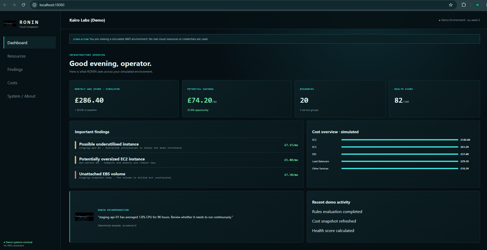
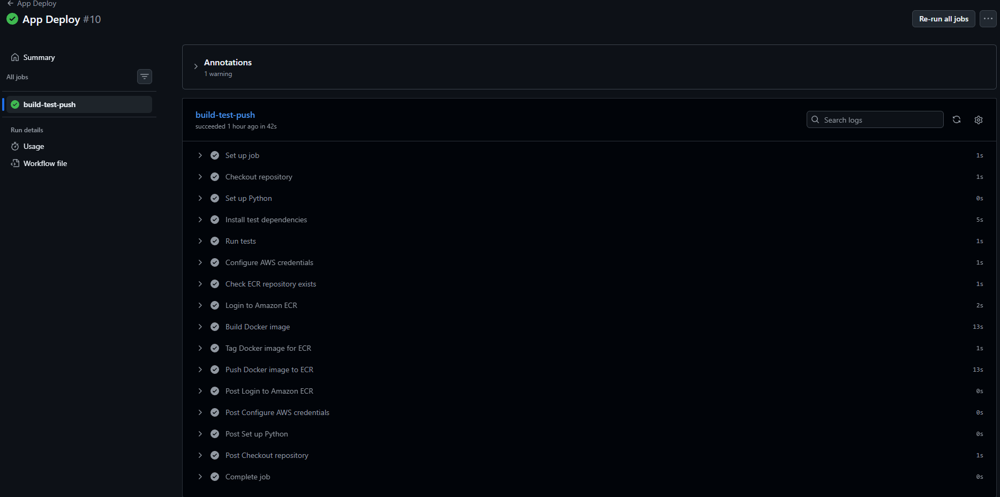
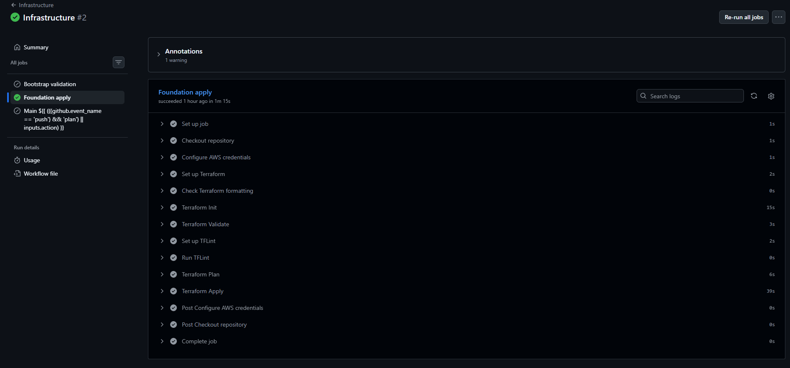
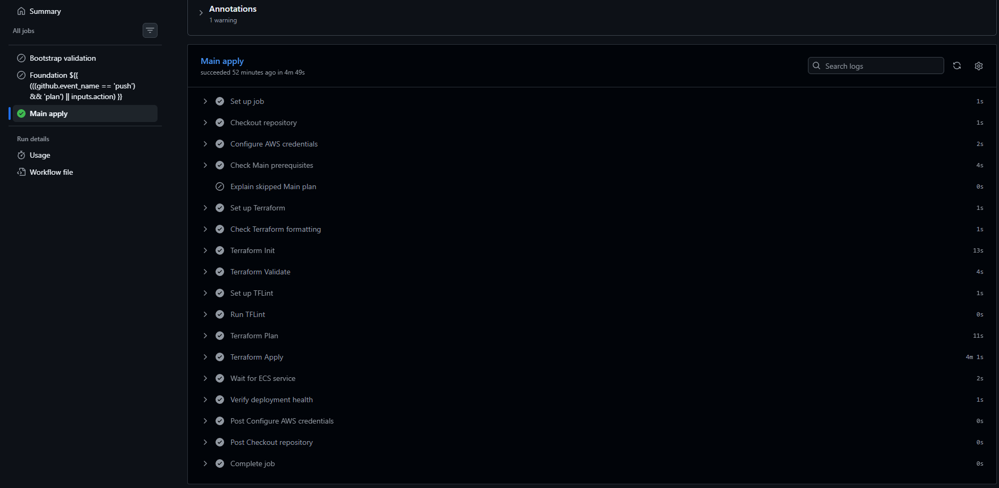
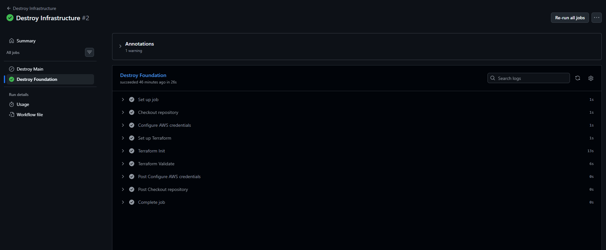
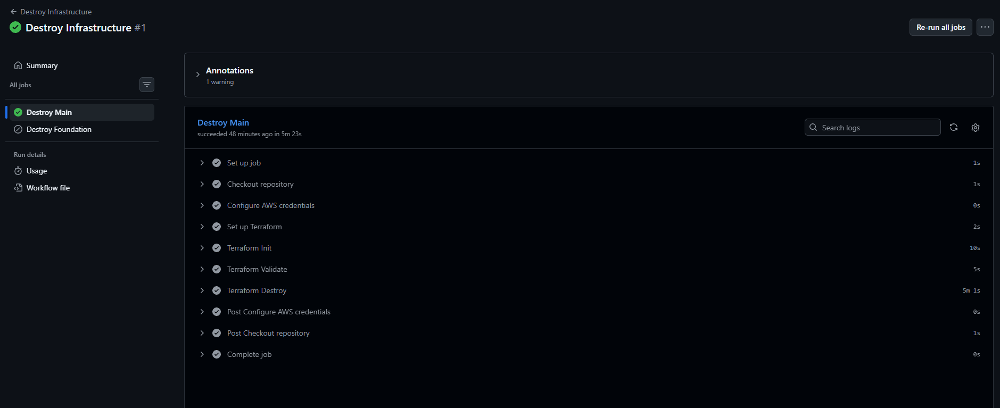

## CHANGES IN PROGRESS  

I am currently making changes to this repo so please keep that in mind if you are viewing. 


# RONIN

RONIN is a BYO small Flask application built for the ECS portfolio project. It uses safe demo data to identify possible AWS infrastructure issues, underused resources and optimisation opportunities without connecting to a real customer account.

The project demonstrates how an application can be tested, containerised, deployed and removed using Docker, Terraform, AWS and GitHub Actions.

## App Demo

The deployed application is served securely at `https://ronin.humdaan.co.uk` through CloudFront, with HTTPS visible in the browser.


The interface lets a user review findings calculated from the demo environment and simulate recommended actions.

## Local Setup

### Requirements

- Docker
- Git

### Run with Docker

```bash
git clone https://github.com/rafiquehumdaan-alt/RONIN.git
cd RONIN
docker build -t ronin:local ./app
docker run --rm -p 8080:8080 ronin:local
```

Open [http://localhost:8080](http://localhost:8080) in a browser. Stop the application with `Ctrl+C`.

In another terminal, confirm that the required health endpoint works:

```bash
curl http://localhost:8080/health
# {"status":"ok"}
```



## Architecture

RONIN runs in AWS across two Availability Zones. Cloudflare delegates the RONIN subdomain to Route 53, and user traffic travels through CloudFront and an Application Load Balancer to ECS Fargate tasks in private subnets. The tasks use the NAT gateway in their Availability Zone for ECR image pulls, including image-layer downloads. Flask computes findings from demo data when the page is requested.

[Read the architecture and network design](docs/architecture/reasoning.md)

Terraform has two roots:

1. **Bootstrap** uses local state to create the S3 remote state bucket and GitHub OIDC access.
2. **Main** uses that backend and manages the VPC, ECR, DNS, certificates, CloudFront, ALB and ECS.

## CI/CD Pipelines

GitHub Actions connects to AWS through OIDC, so long-lived AWS access keys are not stored in GitHub.

- **Application** builds, smoke-tests and scans the image. Manual deploys push the scanned image to ECR and roll it out to ECS.
- **Terraform** checks the configuration on pushes and pull requests. Use the manual workflow to plan, apply or destroy Main.

The screenshots below show earlier workflow runs.

### App build and deployment



### Foundation deployment



### Main infrastructure deployment



### Main infrastructure destruction



### Foundation destruction



## Deploying from Zero

The full environment is created in this order:

1. Run `terraform init` and `terraform apply` locally in `terraform/bootstrap`.
2. Run the **Terraform** workflow with the `apply` action to create Main with ECS at zero tasks.
3. Run the **Application** workflow with the `deploy` action to push the image and start ECS.

Use the **Terraform** workflow with the `destroy` action to remove Main. Keep Bootstrap if the backend and OIDC role are still needed.

## Main Technologies

Docker, Terraform, AWS ECS Fargate, ECR, VPC, ALB, CloudFront, Route 53, ACM, S3 (Terraform state), CloudWatch, Cloudflare and GitHub Actions.

## TIME LOG: 59 HOURS
