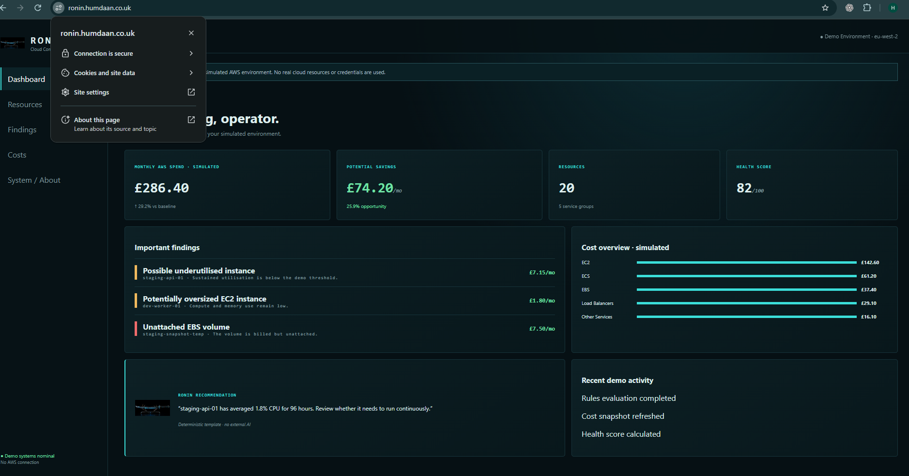
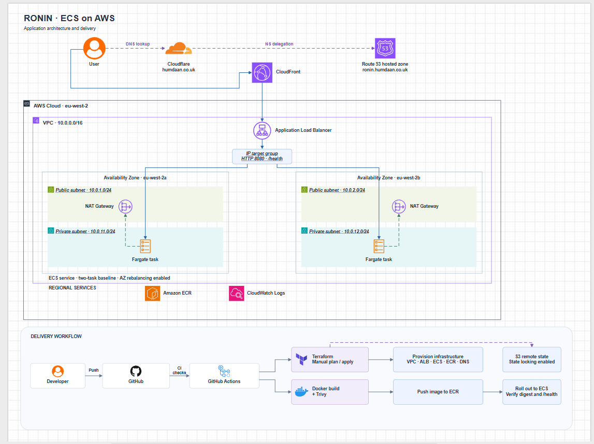
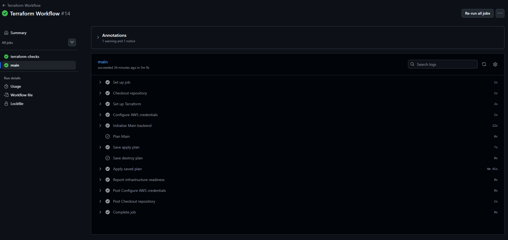
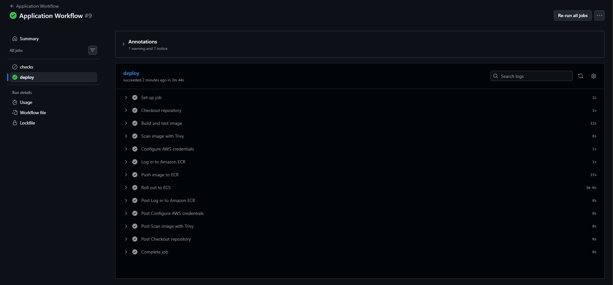

# RONIN on Amazon ECS

Welcome to RONIN. I built it to explore how a small Flask app goes from a Docker image to a running service on AWS. The project covers the infrastructure, how I release updates, and how I check that the right version is live.

## The application

RONIN reviews a sample AWS environment and flags things like unattached EBS volumes and EC2 instances with low utilisation. You can read each finding, see why it was flagged, and try the suggested action using demo data.

When the environment is running, you can try it at [ronin.humdaan.co.uk](https://ronin.humdaan.co.uk). The site may be offline when the AWS stack is torn down.

## How it fits together

The app runs on Amazon ECS Fargate in the AWS London region. The tasks run in private subnets across two Availability Zones. Amazon ECR stores the Docker images, and CloudWatch Logs collects the container logs.

Cloudflare delegates the RONIN subdomain to Route 53. Visitors connect to CloudFront over HTTPS. CloudFront forwards app requests to an Application Load Balancer, which routes them to healthy Fargate tasks.

I split Terraform into two parts. Bootstrap creates the S3 bucket for remote state and the AWS role used by GitHub Actions. The main configuration uses that backend and provisions the application infrastructure.

### AWS architecture

## Deploying changes

I use two GitHub Actions workflows so I can change the infrastructure and release the app independently. Both use GitHub OIDC to get temporary AWS credentials for deployment.

### Terraform workflow

The Terraform workflow checks formatting, validates the configuration, and runs TFLint and Checkov. These checks run on relevant pushes and pull requests, and before a manual plan, apply or destroy. Checkov findings are advisory.

Choose **plan** to preview changes. Choose **apply** or **destroy** to generate a saved plan and apply it in the same run.

See the [Terraform workflow](.github/workflows/terraform.yaml) and the [destroy run screenshot](documentation/screenshots/terraform-workflow-success-destruction.png).

### Application workflow

The application workflow builds the Docker image, starts a container to smoke-test the health endpoint, and scans the image with Trivy. On a manual deploy from **main**, it pushes that same image to ECR with a run-specific tag and the **latest** tag.

The deploy script starts a new ECS rollout. Once the service stabilises, the script checks that the running tasks use the image digest from that workflow run and that the public health endpoint responds.

See the [application workflow](.github/workflows/application.yaml).

## Further documentation

- [System design](documentation/system-design.md) explains what the app does, how it runs on Fargate, and how the service scales.
- [Networking](documentation/networking.md) covers the VPC layout, DNS, and the path requests take from the browser to the app.
- [Security](documentation/security-overview.md) covers network access, HTTPS, IAM roles, and Terraform state.
- [CI/CD](documentation/cicd-overview.md) walks through both workflows, when they run, and how a release is verified.
- [Future improvements](documentation/future-improvements.md) describes what I’d add in a future version.